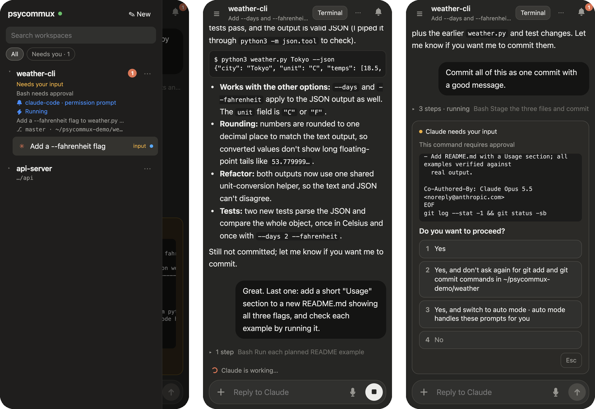
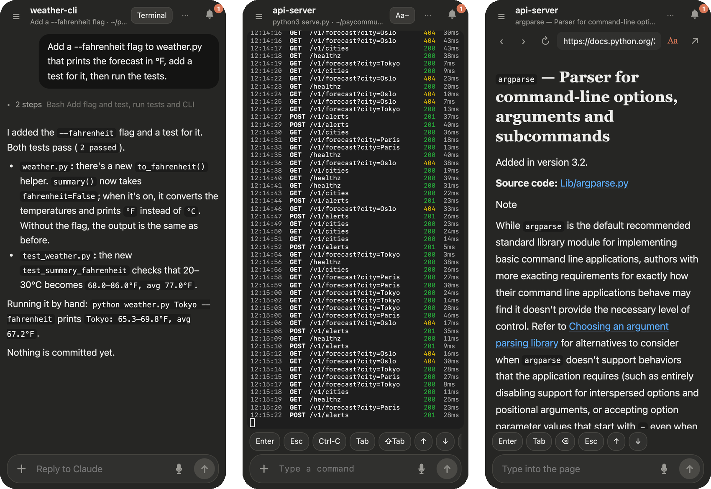

# psycommux

Drive [cmux](https://cmux.com) from your phone. psycommux is a small server you
run on the Mac next to cmux, and an installable web app (PWA) that looks and
works like the Claude app, with cmux's workspaces as the organizing layer.

The name comes from Gundam's psycommu, the system a Newtype uses to steer a
swarm of remote funnels: here, one phone steering many coding agents.



<details>
<summary>A finished Claude reply, a terminal, and a browser panel in reader mode</summary>



</details>

- **Drawer**: cmux's workspaces, each expandable to what it holds: Claude
  Code sessions (✳), terminals (›_), browsers (◍), Markdown documents (¶) and
  file previews (▤). Each row shows what the Mac's sidebar shows, in its
  order: description, latest notification, SSH target, status entries and
  Markdown blocks, newest log line, progress, branch and directory, pull
  request and ports, plus a spinner while an agent works, "Needs your input"
  when one waits on you, and the unread count. It follows the Mac's Settings >
  Sidebar choices, read from cmux's defaults (`com.cmuxterm.app`), except that
  a notification shows at most 3 lines until tapped. Status icons, SF Symbols
  on the Mac, are drawn with [Lucide](https://lucide.dev) icons. On a phone a
  closed row is two lines, the name and what matters most (an agent waiting, a
  colored status, the latest notification), and only the open workspace stays
  unfolded; "Needs you" lists just the workspaces with unread notifications or
  an agent waiting.
- **Workspace and panel menus**: ⋯ on a workspace row renames, pins, marks
  read or unread, opens a terminal or a Claude session there, evens out the
  Mac's splits, or closes it; ⋯ in the header does the same for the open panel
  (rename, new terminal or browser tab, split on the Mac, move to a new
  workspace, close). Closing asks first, and asks again if a program is still
  running there.
- **Resume**: a Claude session that has ended offers "Resume session", which
  runs `claude --resume <id>` in its terminal from the folder it ran in.
- **Claude Code sessions** open as a chat read from the session's transcript:
  your messages as bubbles, replies as Markdown, tool calls folded into steps
  with diffs and output, AskUserQuestion as tappable options (multiple-choice
  questions and several questions at once are ticked on the cards and sent
  with Submit answers), and permission prompts as the question with Claude's
  own labelled choices. The composer sends a prompt; while Claude works its
  button stops it. A Terminal switch shows the raw screen.
- **Terminals** live and in color, with keys (Enter, Esc, Ctrl-C, Tab, ⇧Tab,
  arrows, Ctrl-D, PgUp/PgDn).
- **Browsers** open in reader view: the page's main content laid out as the
  phone's own text, sharp and sized for the phone, with links that navigate
  the panel. The address bar has back, forward and reload, plus **Aa** to
  switch a panel to its live screenshot and **↗** to open the page in the
  phone's own browser (with the phone's login, and the site's own mobile
  layout). The screenshot is rendered at the device's size and sent as
  lossless WebP: tap to click, drag or wheel to scroll (the screenshot follows
  the finger at once, glides after a flick and settles as the page catches
  up), and type into the focused field; it is the way to use forms.
- **Markdown and file previews** rendered, following the file as it changes.
- **New session**: pick a folder, optionally describe a task; a new workspace
  starts `claude` there and opens its chat.
- **Dictation**: the composer's mic button types what you say at the caret,
  using the browser's speech recognition (Chrome sends the audio to Google,
  Safari to Apple). It starts in Chinese when Chinese is among the system
  languages; a button on the recording bar switches language, and ✕ restores
  the text from before. Review the text, then send. The button is hidden where
  the browser has no speech recognition, and on iPhone and iPad, where WebKit
  hears only the first dictation after the page loads (WebKit bugs 317741 and
  321436); use the keyboard's own dictation key there.
- **Photos and files for Claude**: the composer's + button (or pasting an
  image, or dropping a file on a computer) sends photos, screenshots and files
  to the Mac, into `~/.psycommux/uploads`, and puts each file's path in the
  message for Claude to read. Files there are removed after a week.
- **Secrets for agents**: when an agent needs a password or token it cannot
  get itself (1Password asking for Touch ID on the Mac while you are away), it
  runs `psycommux secret`; the phone shows the request, and the value you
  paste or autofill there goes straight to the waiting command. See
  [Secrets](#secrets).
- **Notifications** in a list laid out like cmux's; opening an item marks its
  notifications read. With **push** turned on (Notifications > Enable), each
  new cmux notification reaches the phone while the app is closed, as long as
  the Mac's screen is locked or it has sat idle for 2 minutes
  (`--push-always` drops that condition). Tapping one opens its workspace.

One self-contained binary: the page, script and styles are compiled in.

## Install

Needs Rust 1.88 or newer.

```bash
cargo install --git https://github.com/hongqn/psycommux
```

Or from a checkout: `cargo install --path .`

## Run

Start it **from a terminal inside cmux**. cmux's default socket mode,
`cmuxOnly`, trusts processes started from cmux terminals, so no socket password
is needed:

```bash
psycommux
```

Keep it in the foreground of that terminal (or a child of it, such as an
agent's background task). `cmuxOnly` checks the process ancestry, so `nohup
... &`, `launchd` or a detached `screen` reparent psycommux away from cmux and
the socket answers `Access denied`; psycommux then exits with that message. To
run it detached, switch cmux's socket to `password` mode and export
`CMUX_SOCKET_PASSWORD`.

It prints a one-time login URL such as
`http://127.0.0.1:8787/login?token=...`. Opening it sets an HttpOnly cookie for
30 days. Set `PSYCOMMUX_TOKEN` to keep the same token across restarts.

| Option / env | Meaning |
| --- | --- |
| `--host`, `--port` | Bind address, default `127.0.0.1:8787`. |
| `--socket` / `CMUX_SOCKET_PATH` | cmux socket. Defaults to the one the surrounding cmux terminal exports. |
| `CMUX_SOCKET_PASSWORD` | Socket password, when cmux's socket mode is `password`. |
| `PSYCOMMUX_TOKEN` | Fixed access token instead of a random one. |
| `--public-url <url>` | The URL other devices use, printed as a QR code and allowed as an origin. Defaults to the `tailscale serve` HTTPS name that proxies to `--port`, or `http://<--host>:<port>` for a specific non-loopback `--host`. |
| `--tls-cert <pem>`, `--tls-key <pem>` | Serve HTTPS directly. The key may live in the cert file; without `--tls-key`, `<name>.key` next to `<name>.crt` is used, as `tailscale cert` writes them. With a certificate for a DNS name, the phone URL and QR code use that name. |
| `--allow-origin <url>` | Extra origin allowed to POST, e.g. when a proxy rewrites `Host`. |
| `--no-qr` | Print the phone URL without the QR code. |
| `--access-log` | Log every request. Off by default: only errors are logged, because a log line per poll would keep changing psycommux's own terminal, and a page watching that terminal would poll again at once, forever. |

## Use it from your phone

Do not bind to `0.0.0.0` on an open network: whoever has the token can type
into your terminals, which means running any command as you. Put an
authenticated, encrypted tunnel in front of it. With
[Tailscale](https://tailscale.com), either proxy it:

```bash
tailscale serve --bg --https=443 http://127.0.0.1:8787
psycommux            # finds the Serve name and prints a QR code for it
```

or serve HTTPS on the Mac's tailnet address with a Tailscale certificate
(enable HTTPS in the tailnet's DNS settings first):

```bash
tailscale cert mac.example.ts.net                          # writes .crt and .key
psycommux --host 100.x.y.z --tls-cert mac.example.ts.net.crt
```

Scan the QR code, then add the page to the Home Screen: it opens as a
standalone app, and on iOS (16.4+) that is also what browser notifications
need. Plain HTTP on the tailnet address works too, but browsers treat it as
insecure, so the page cannot show notifications.

Tailscale certificates come from Let's Encrypt, so the Mac's tailnet name
appears in public Certificate Transparency logs, and they expire after 90
days: rerun `tailscale cert`, then restart psycommux.

## Secrets

An agent (or any program of yours) asks for a value it does not have:

```bash
psycommux secret "Deploy key for staging" --out ~/.cache/staging-key   # file, mode 600
psycommux secret "GitHub token for gh" --stdout | gh auth login --with-token
```

The request shows at the top of the page on the phone, as a cmux
notification, and names the workspace that asked. Tap it, fill the field with
1Password's autofill (Face ID on the phone) or paste, and Send; or Decline.
The command waits up to `--timeout` seconds (600 by default) and exits nonzero
when declined or unanswered, so an agent should run it with a long enough
timeout or in the background.

The command reaches the server through `~/.psycommux/secret-<port>.sock`,
which only your user can open. The value travels from the phone to that
command and nowhere else: psycommux keeps no copy, and neither the page nor
the server logs it. `--stdout` refuses to print to a terminal. Ask for one
value per request, and remove `--out` files when they are no longer needed.

## Push notifications

On iPhone, add the page to the Home Screen first (iOS 16.4+) and open it from
there; on Android, Chrome, Edge and Firefox can subscribe from a plain tab.
Tap Enable at the bottom of the notifications panel and allow
notifications; "Send a test" checks the whole path. The page must be served
over HTTPS, as with Tailscale above.

psycommux sends pushes through the phone's push service (Apple's, for an
iPhone), encrypted for that phone (RFC 8291) and signed with a key of its own
(VAPID, RFC 8292), so the push service cannot read them. The key and the
phones' subscriptions are kept in `~/.psycommux/push.json` (mode 600); delete
it to start over, and the phones subscribe again the next time they tap
Enable. A subscription the push service reports gone is dropped.

## How it works

```
phone ──HTTP/SSE──▶ psycommux ──unix socket──▶ cmux.app
                       ├─ one long-lived events.stream
                       ├─ one short connection per API call
                       └─ reads Claude Code transcripts and cmux's saved session
```

| HTTP | cmux |
| --- | --- |
| `GET /api/tree` | `system.tree`, `extension.sidebar.snapshot`, `chat.sessions.dump`, and cached v1 `sidebar_state` (status pills, log, progress) |
| `POST /api/screens {surfaces: {id: revision}}` | Waits until any listed terminal changes (`surface.wait_text_change`, or `surface.read_text` polled on older cmux), with colors from `terminal.replay` |
| `POST /api/send`, `/api/key`, `/api/peek` | `surface.send_text`, `surface.send_key`, `surface.read_text` |
| `POST /api/chat/{history,poll,send,interrupt} {session_id}` | The session's transcript, read backwards in pages and forward from a byte offset; `mobile.chat.send` / `mobile.chat.interrupt` |
| `POST /api/chat/resume {session_id}` | `surface.send_text` of `cd <folder> && claude --resume <id>` into an ended session's terminal |
| `POST /api/browser/{shot,act,release}` | `browser.screenshot` (answered as WebP bytes, or 204 when unchanged), `browser.viewport.set`, `browser.eval` (taps, scrolls, typing, reader view), `browser.press`, `browser.navigate` |
| `POST /api/upload` (the file as the body, its name in `X-Filename`) | Saved as `~/.psycommux/uploads/<random>-<name>` (0600); answers `{path}` |
| `POST /api/file {surface_id}` | The file a Markdown or file-preview panel shows |
| `POST /api/session/new {cwd, prompt?}` | `workspace.create` with `initial_input: "claude '<prompt>'\n"` |
| `POST /api/workspace/{select,create}` | `workspace.select`, `workspace.create` |
| `POST /api/workspace/action {workspace_id, action, title?, force?}` | `rename` → `workspace.rename`; `pin`, `unpin`, `mark-read`, `mark-unread` → `workspace.action`; `equalize` → `workspace.equalize_splits`; `close` → `workspace.close` (409 `confirmation_required` while something runs, unless `force`) |
| `POST /api/surface/action {surface_id, action, title?, url?, force?}` | `rename`, `new-terminal-right`, `new-browser-right`, `move-to-new-workspace` → `tab.action`; `split-right`, `split-down` → `surface.split`; `close` → `surface.close` |
| `GET /api/notifications`, `POST /api/notifications/{read,dismiss,clear_all}` | `notification.*` |
| `GET /api/secrets`, `POST /api/secrets/{answer,decline} {id, value?}` | Open `psycommux secret` requests; the answer goes back over the local socket, with `notification.create` / `notification.dismiss` around it |
| `GET /api/push`, `POST /api/push/{subscribe,unsubscribe,test}` | The VAPID public key and this device's Web Push subscription; pushes follow `notification.created` events |
| `GET /api/events` (SSE) | `events.stream`, with notification bodies looked up (the stream redacts them) |

API calls also accept `Authorization: Bearer <token>`:

```bash
curl -H "Authorization: Bearer $PSYCOMMUX_TOKEN" http://127.0.0.1:8787/api/tree
```

### Limits

- Terminals are redrawn from snapshots, not streamed byte by byte.
- A browser panel off the Mac's screen has no layout, so while you look at one
  psycommux lays it out at your phone's size with `browser.viewport.set`. The
  Mac shows that panel scaled until you leave, or 20 seconds after the phone
  stops looking. Taps are synthetic clicks through `browser.eval`, so pages
  that check for trusted input events ignore them. Screenshots of an emulated
  viewport come at one pixel per CSS pixel, so they are softer than the
  phone's screen; cmux has no sharper capture, and WKWebView has no screencast
  or real input events.
- The socket does not say which file a Markdown panel shows, so psycommux
  reads `filePath` from cmux's saved session
  (`~/Library/Application Support/cmux/session-com.cmuxterm.app.json`). That is
  cmux's internal format; if it changes, those panels show "not available".
- Only Claude Code sessions open as chats; Codex sessions show their terminal.

## Security

- Every API route needs the token (cookie or bearer), compared in constant time.
- The cookie is `HttpOnly; SameSite=Lax` (`Secure` over HTTPS). Not
  `Strict`: an iOS Home Screen app launched cold opens the page as if from
  another site, and would ask for the token every time. State-changing
  requests must be JSON POSTs (or file uploads) from the same origin, or
  carry no `Origin`, as from curl.
- The token never appears in the log.
- Transcript paths stay on the server; the page names sessions by the ids cmux
  reports.
- The browser address bar accepts only http and https URLs.
- Reader view never parses the page's HTML: the page returns a tree of plain
  tags with only http(s) link targets and image sources, and the phone builds
  elements from it, so no script or style from the page runs on psycommux's
  origin. Its images load straight from their https URLs (the page's CSP
  allows `img-src https:` for that), without a referrer; images that need the
  Mac's login show their alt text instead.
- A secret sent from the phone reaches only the `psycommux secret` command
  waiting for it, over a socket in a directory only your user can open.
  Whoever has the token can answer a request, and any program of yours can
  make one, so read the label and workspace before you send.
- `/api/send` skips the "don't type over an agent's prompt draft" check that
  `cmux send` does. Check the screen before you send.

## Development

```bash
cargo test
```

The tests run psycommux against a fake cmux socket, so they need neither cmux
nor a network. The TLS tests make a throwaway certificate with `openssl` and
call `curl`.

## License

MIT. See [LICENSE](LICENSE). The Lucide icons are under their own terms, in
[LICENSE-LUCIDE](LICENSE-LUCIDE).
